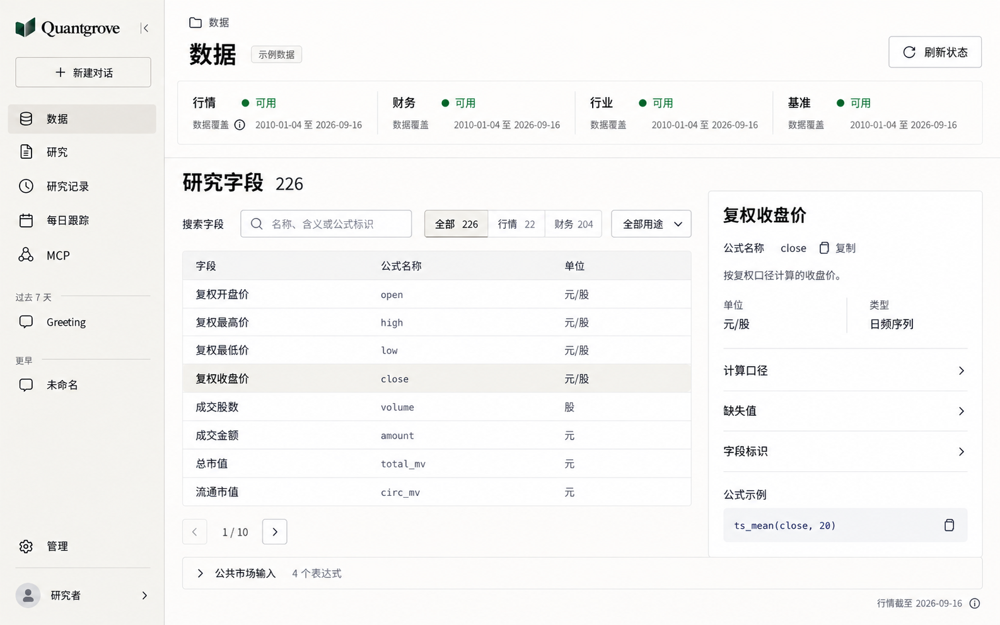
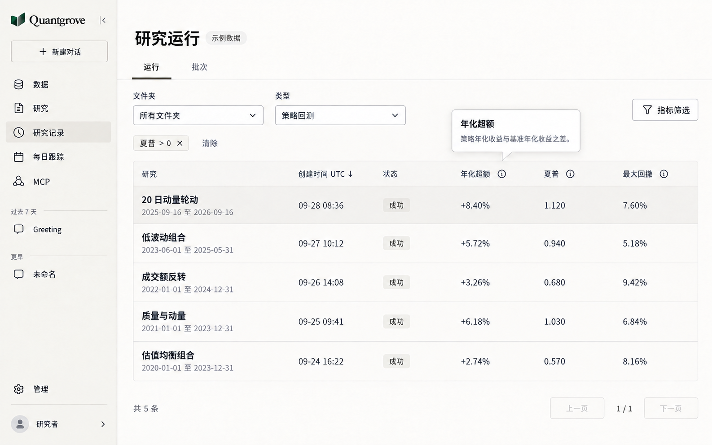
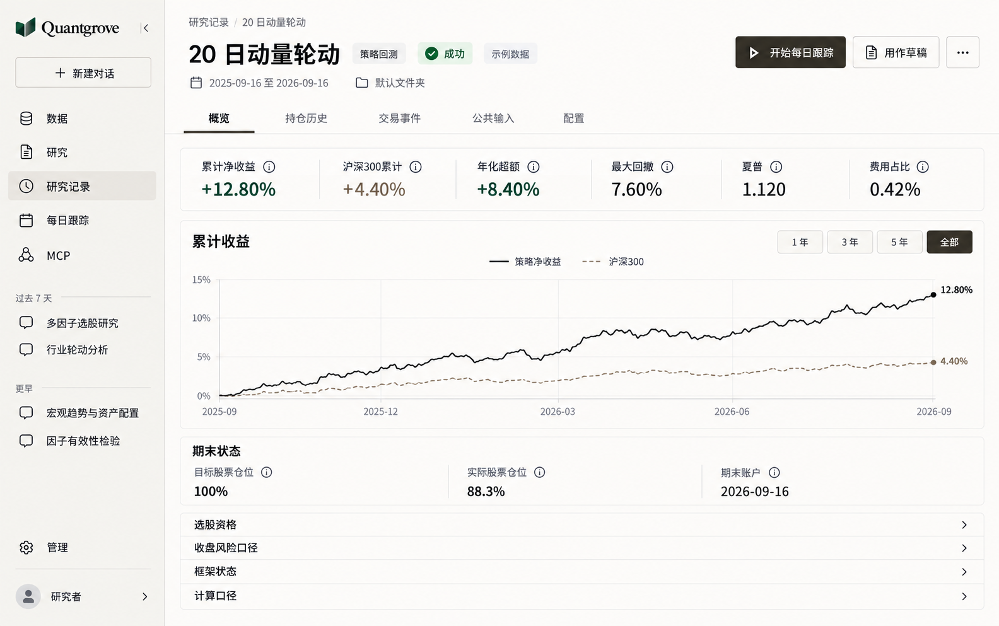
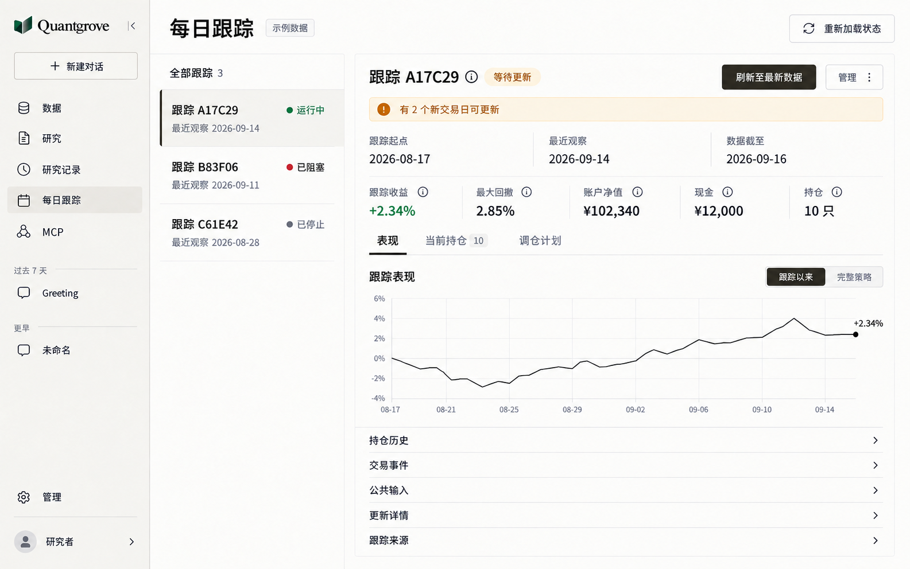
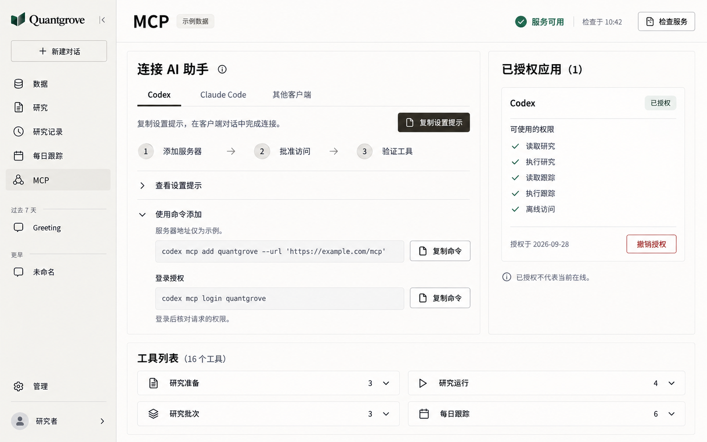
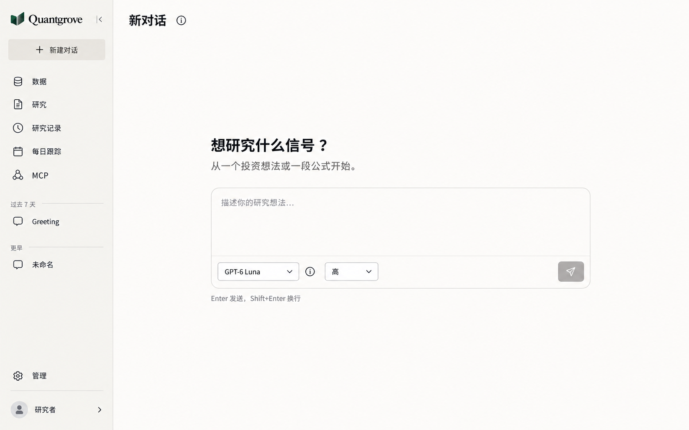
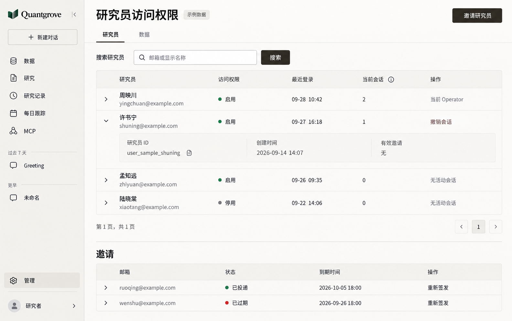

# Quantgrove 其他工作区页面设计 v1

日期：2026-09-29。状态：桌面高保真设计稿，尚未实施到应用代码。共 7 张，延续已确认的 [Research v3](research-workbench-v3.md) 与 [DESIGN.md](../../DESIGN.md)。

## 设计判断

面向量化研究者的产品界面改版，保留 Quantgrove 品牌和现有功能，减少常驻说明，把空间留给检索、研究证据和操作。参数为 `DESIGN_VARIANCE: 4`、`MOTION_INTENSITY: 2`、`VISUAL_DENSITY: 4`。

采用现有 React、shadcn/Base UI、Phosphor、CodeMirror 与 Lightweight Charts。design-taste-frontend 的审查、排版、密度和品牌约束适用；营销页的 Hero、摄影、动效、双主题规则不套用到这些产品页面。主题和桌面验收范围遵循仓库 DESIGN.md 与 AGENTS.md。

## 本轮审查

已在本地应用检查数据、研究记录、每日跟踪、MCP、对话初始状态、研究员管理和策略结果详情，并对照对应组件。只读取页面，没有提交回测、刷新跟踪、修改权限或发出聊天消息。

| 页面 | 当前问题 | 本稿调整 |
| --- | --- | --- |
| 数据 | 覆盖说明占首屏，字段检索位于下方 | 覆盖压成横向摘要，目录和字段定义并排 |
| 研究记录 | 宽筛选表单占空间，结果摘要分散，窄一些的桌面会横向滚动 | 紧凑筛选，按研究类型对齐指标列 |
| 策略结果 | 指标和说明占较多空间，创建草稿位于长页面下部 | 指标成一排，图表优先，后续动作进入页头 |
| 每日跟踪 | 长 ID 为主要入口，列表和观察内容分离 | 短 ID 导航与详情并列，完整 ID 按需查看 |
| MCP | 服务状态、步骤和说明重复占空间 | 连接操作集中，授权应用独立，工具详情折叠 |
| 对话 | 初始介绍混合了用户目标与内部模型说明 | 聚焦输入，模型和聊天范围说明按需查看 |
| 管理 | 长 ID 和低频字段令研究员表格过宽 | 常用列留在表格，ID、创建时间与邀请详情按行展开 |

只把说明收起。数据缺口、阻塞原因、失败信息、操作后果、单位和时间口径仍须直接可见。主导航顺序、URL、资源身份、权限和业务契约保持一致。内部页面无需调整公开站点的 SEO、元信息或登录流程。

## 数据

主任务是找字段。首屏同时容纳覆盖状态、搜索、分类、目录和选中字段的定义。字段名称、标识、单位、缺失值和公式示例继续来自当前 Catalog，不能按图片重新定义。

覆盖摘要仍区分行情、财务、行业和基准。部分可用、待补齐、数据缺口与最新成功日期必须保留；异常时展开简短原因，不能一律显示“可用”。

入口：`/data`。实现依据：[DataPage.tsx](../../apps/web/src/data/DataPage.tsx)。

## 研究记录

保留“运行 / 批次”、文件夹、研究类型、排序和指标筛选。图中展示策略回测筛选后的列；因子评估使用 1、5、20 日 Rank IC，混合类型继续显示各自的结果语义，不能把不同类型的指标混为同一列。

“指标筛选”打开现有规则的编辑面板，已应用条件直接可见。没有新增全文搜索、状态筛选、批量比较或导出能力。批次子页沿用同一页头、表格、分页与状态层级，取消行为仍由现有契约控制。

入口：`/research-runs`、`/research-runs/batches`。实现依据：[ResearchRunList.tsx](../../apps/web/src/research-runs/ResearchRunList.tsx)。

## 策略结果详情

成功状态先展示六项现有指标与策略/基准曲线，指标定义由信息按钮打开。运行中先显示进度，失败先显示具体原因；没有结果的状态不能套用成功页面。

“用作草稿”打开包含目标文件夹的现有流程，不省略草稿替换确认。删除进入次级菜单并保留确认。开始跟踪只对当前允许的成功策略结果出现。因子结果仍使用独立的指标与证据视图。

图中日期、收益、曲线、费用与持仓均为视觉示例，没有执行新的研究，曲线不是可供复算的金融数据。正式实现必须使用现有结果与同一计算口径。

入口：`/research-runs/:id`。实现依据：[ResearchRunsPage.tsx](../../apps/web/src/research-runs/ResearchRunsPage.tsx)、[StrategyResultView.tsx](../../apps/web/src/research-runs/StrategyResultView.tsx)。

## 每日跟踪

左侧选择跟踪，右侧显示当前观察。列表采用缩短的真实 ID，完整 ID 保留在可访问的信息入口；不凭空增加策略名称。直接访问详情 URL 时选中对应项，返回列表与浏览器历史仍有效。

跟踪列表显示生命周期状态；详情显示更具体的更新状态。“重新加载状态”是读取动作，“刷新至最新数据”会发起更新，必须保持两者的名称和视觉区别。不会因为切换列表而触发更新。

保留跟踪收益、最大回撤、账户净值、现金、持仓、表现/当前持仓/调仓计划，以及持仓历史、交易事件、公共输入、更新详情和来源。有新交易日、阻塞和停止的提示直接显示。停止与删除继续使用现有确认流程。

入口：`/daily-tracks`、`/daily-tracks/:id`。实现依据：[DailyTracksPage.tsx](../../apps/web/src/daily-tracks/DailyTracksPage.tsx)、[DailyTrackWorkspace.tsx](../../apps/web/src/daily-tracks/DailyTrackWorkspace.tsx)。

## MCP

连接提示为主要动作，命令方式与完整说明按需展开。服务检查、工具发现与应用授权分别表达自己的状态，不用“已连接”混淆不同事实。

图中的服务地址 `https://example.com/mcp`、授权应用和时间都是示例。真实地址、工具数、权限与授权时间必须来自现有接口。保留 Codex、Claude Code、其他客户端以及真实客户端别名 `quantgrove`。授权不代表当前在线，撤销权限保留确认与影响说明。

入口：`/connections/mcp`。实现依据：[McpPage.tsx](../../apps/web/src/mcp/McpPage.tsx)、[McpSetup.tsx](../../apps/web/src/mcp/McpSetup.tsx)。

## 对话

统一 720px 阅读和输入边界，去掉装饰性 Alpha 符号和重复介绍。模型选择、推理强度与发送保持现有能力；模型名称仍来自实际注册表。

图中只展示初始状态。已有对话继续保留消息、工具调用、A2UI、正在生成、停止、重试与错误，不把对话记录转换为图片中的静态内容。模型和当前聊天范围说明可按需查看，“仅支持文字”的能力限制仍能通过入口到达。没有增加上传、语音或联网模式。

入口：`/chat`。实现依据：[ChatPage.tsx](../../apps/web/src/chat/ChatPage.tsx)。

## 管理

主表突出研究员、访问状态、最近登录、当前会话及操作。完整 ID、创建时间和有效邀请留在行详情。图中姓名、邮箱和 ID 均为虚构示例，邮箱使用保留的 example.com 域名。

访问状态只展示，不增加权限切换器。当前 Operator 的会话保护、邀请投递状态、重发和撤销会话流程均保留。撤销会话不能被写成删除账户或禁用研究员。

本图展示研究员分区；数据运维分区沿用同一页头与浅色控件系统，保留行情/财务/行业各自的日期、范围、任务状态与提交前确认。不得把刷新控件变成一个语义模糊的通用按钮。

入口：`/operator/researchers`、`/operator/data`。实现依据：[OperatorResearchersPage.tsx](../../apps/web/src/operator/OperatorResearchersPage.tsx)。

## 交互与实现约束

- 字段名、数值、单位、日期、错误与主要动作常驻。短解释使用可悬浮、点击、键盘打开的现有信息型 Popover；长说明使用折叠区或详情面板。
- 不把整个数据表压成小字号。先收起低频列、限制名称宽度并提供完整值，再按数据密度选择必要的横向滚动。
- 图中状态颜色只是语义强调，仍有文字。无数值时沿用 DESIGN.md 规定的占位及原因，不根据图片生成假值。
- 沿用仓库浅色主题、品牌标识和字体，不新增组件库或主题开关。图片中像素级色差与图标形状不作为新 token；实现以 DESIGN.md 和已有组件为准。
- 桌面重点核对 1280px、1440px、展开/收起侧栏、中英文和长内容。遵循仓库要求，不安排手机或窄屏验收。
- 保留加载骨架、空状态、局部失败、过期数据提醒、禁用/处理中动作、焦点恢复与键盘导航。这组静态图只展示代表状态，不证明交互已实现。
- 图表使用当前 Lightweight Charts 与真实接口数据，保留图例、工具提示、范围控制、缩放和署名。
- 本轮没有改应用代码，因此未运行代码测试。已完成实际页面/源码审查、七张图的视觉检查与文档链接检查。后续实施按受影响行为选择类型检查、组件测试和真实桌面浏览器验收。

## 文件与生成记录

七张 PNG 均保存到本文件所在目录，采用内置 `image_gen`，以已有 Research v3 稿作为外框和品牌参照。完整提示词及定向修订见 [生成提示词](console-redesign-v1-prompts.md)。

这些图片是设计提案，不是已上线页面的截图。
