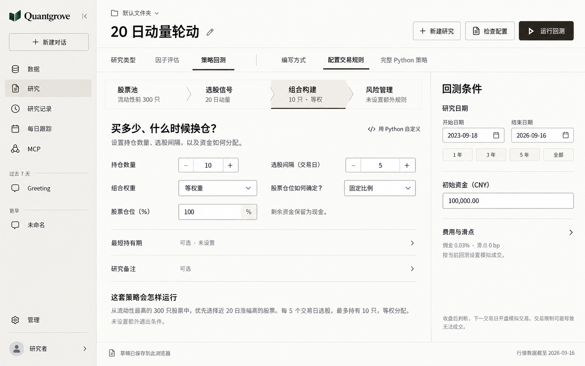
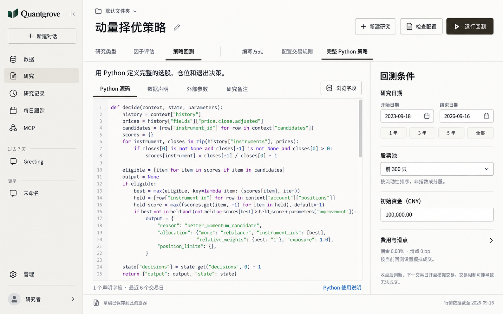
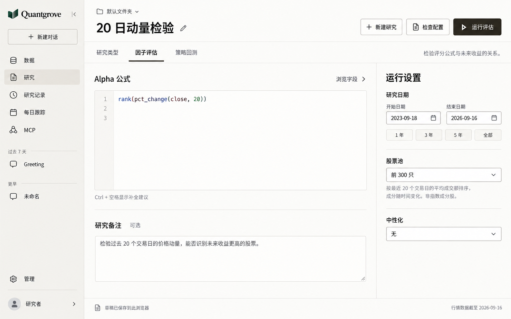

# Research 工作区布局重设计 v2

日期：2026-09-28。状态：高保真桌面界面方案，尚未实施为页面代码。生成方式：内置 `image_gen`，使用现有 Quantgrove 品牌图作为身份参考；Python 与因子稿沿用规则稿的外框。三张图片均使用示例研究配置，不代表已保存、验证或运行成功的研究。

本方案根据当前页面、[DESIGN.md](../../DESIGN.md)、实际规则模块和完整 Python 契约重新组织布局。相较 [v1](research-workspace-concept-v1.md)，主要变化是编辑流程和页面结构。

## 统一外框

```text
┌────────────┬─────────────────────────────────────────────────┐
│            │ 文件夹 / 可编辑研究名       新建  检查  运行     │
│ 全局导航   ├─────────────────────────────────────────────────┤
│            │ 研究类型                   策略编写方式         │
│            ├───────────────────────────────┬─────────────────┤
│ 对话历史   │ 当前编辑内容                  │ 运行条件        │
│            │                               │ 日期、资金等    │
│            │ 按模式采用不同的内部结构      │                 │
│ 管理/账户  ├───────────────────────────────┴─────────────────┤
│            │ 本地草稿状态                         数据日期   │
└────────────┴─────────────────────────────────────────────────┘
```

- 全局导航沿用现有顺序、历史、管理和账户；展开宽度沿用 224px。
- 研究名称提升为可编辑标题，移除右侧重复的名称输入。空名称仍保留现有默认命名规则。
- 检查与运行放入顶部固定操作区；底部只保留草稿和数据状态，避免重复入口。
- 研究类型和策略编写方式在同一条安静的模式栏中区分两层含义。
- 右侧采用固定设置栏和细分隔线，宽度约 300–320px；复杂设置按已有功能折叠。
- 中间保留主要编辑空间，各模式使用合适的内容密度。研究文本左对齐，数值遵循现有单位和精度。

视觉基准沿用当前 DESIGN：画布 `#FCFCF9`，安静分组 `#F3F2EE`，正文与主操作 `#27251E`，次级文字 `#5B5952`，分隔线 `#DEDDD6`，控件边界 `#8A8880`。绿色保留给品牌。正文和标题使用现有 Inter/Noto Sans SC，衬线只用于 Quantgrove 字标。正式实现的字号、字重、图标、链接色、边界和间距以 DESIGN 的实际 token 为准。

## 策略回测：配置交易规则



顶部用四个模块形成可自由导航的规则结构：

- 股票池：股票池选择和自定义 Python 候选筛选。
- 选股信号：常用排序规则、自定义公式、行业调整或 Python 信号。
- 组合构建：持仓数量、选股间隔、组合权重、固定或动态仓位、最短持有期。
- 风险管理：止损、最长持有期、分批止盈、组合回撤保护或 Python 风险规则。

图中展开“组合构建”。其他模块保留配置摘要，点击后进入该模块的编辑区。这是自由编辑导航，不是必须依次完成的向导；所有现有能力仍可到达。研究备注和“这套策略会怎样运行”保留为次级信息。

右侧承载研究日期、初始资金、费用与滑点。股票池属于规则流程的第一个模块，不在右侧重复出现。

## 策略回测：完整 Python 策略



主编辑区改为 Python 源码、数据声明、外部参数、研究备注四个标签；字段浏览仍打开临时抽屉，Python 使用说明保留独立入口。数据声明承载现有字段列表和历史交易日数，外部参数承载现有 JSON。

完整 Python 负责全部选股、组合和退出决策，因此这一模式不展示四个规则模块。右侧增加这一模式已有的股票池选择，其他回测条件与规则模式一致。图中代码参照当前 `DIRECT_EXAMPLE`，图片只表达界面；实际实现继续使用仓库中的源码与编辑器。

## 因子评估



共用同一外框，主区域只保留公式、字段浏览和研究备注。右侧承载日期、股票池与中性化。隐藏策略编写方式、初始资金、交易费用和风险规则，主动作使用“运行评估”。

## 交互约束

- 切换研究类型、规则模块和 Python 子标签时，保留既有草稿、编辑内容、选择位置与撤销历史。
- 检查配置发现问题时，定位并展开对应模块、标签或设置项，再聚焦错误字段；不把失败隐藏在非当前标签中。
- 运行中沿用当前禁用、待处理、成功和失败语义；固定操作区不得覆盖编辑内容。
- 字段浏览是暂时打开的抽屉，不持续挤占编辑区域。
- 未设置的风险规则明确显示“未设置”，不得用完成图标暗示通过校验。
- 这是界面结构调整，不增加执行模式、后端字段、运行契约或结果指标。
- 三张图均已检查主要文字、模式差异与现有功能入口。尚无代码变更或交互验收；图片不能证明具体交互已经实现。

[完整生成提示词](research-workbench-v2-prompts.md)
