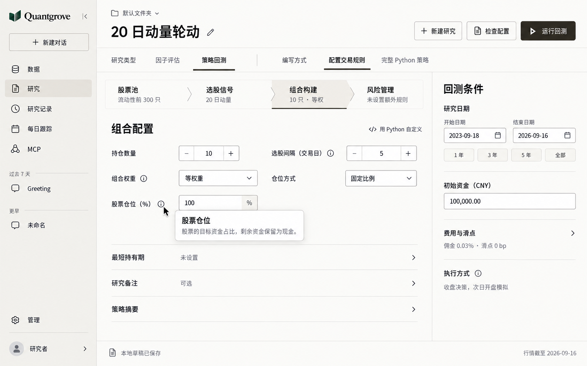
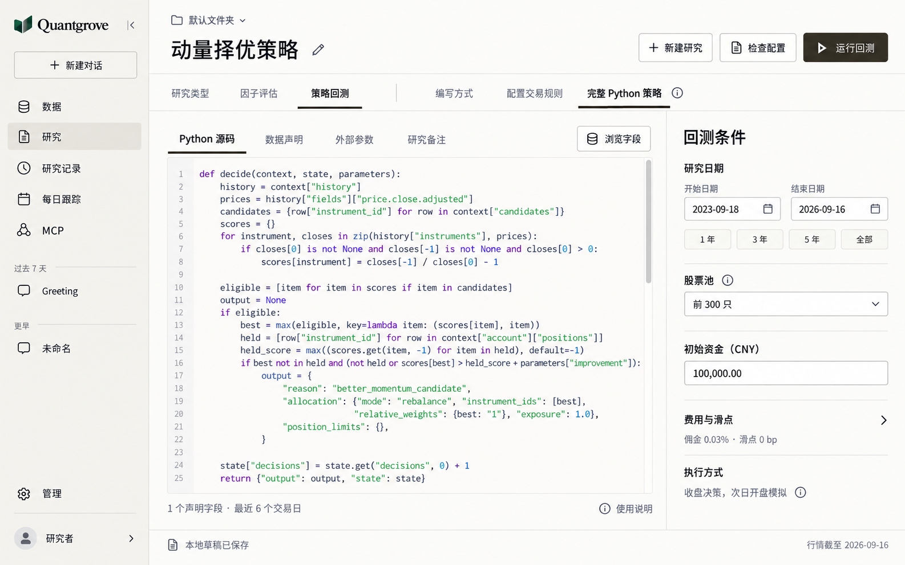
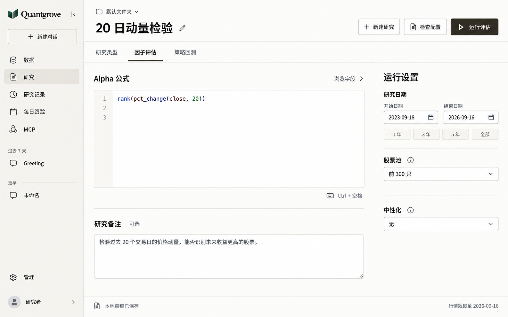

# Research 工作区 v3：精简文案与按需说明

日期：2026-09-28。状态：已实施到 Research 工作区。在 [v2 布局](research-workbench-v2.md) 上精简文案，保留已经认可的页面结构。

Design Read：面向量化研究者的工作区保留式优化，使用克制、清晰的界面语言，沿用 Quantgrove 的 shadcn/Base UI 与 CodeMirror。

参数：`DESIGN_VARIANCE: 4`、`MOTION_INTENSITY: 2`、`VISUAL_DENSITY: 3`。保持布局稳定，仅使用必要的悬浮和焦点反馈，降低说明文字密度。颜色、字体、浅色主题和控件规格继续遵守 [DESIGN.md](../../DESIGN.md)。design-taste-frontend 的展示页专属规则不套用到研究表单和代码编辑器。

## 三种模式

### 规则配置

图中仅展开“股票仓位”的说明浮层，用于展示外观。默认进入页面时所有说明浮层关闭。

### 完整 Python

### 因子评估

## 文案处理

| 内容 | 处理 |
| --- | --- |
| 字段名、当前值、单位、日期 | 直接可见 |
| 校验错误、数据不可用、运行失败、阻止运行的原因 | 在对应字段或操作附近直接显示 |
| 用户编写的公式、Python 源码、研究备注 | 完整保留，不当作冗余说明删除 |
| 模块当前配置摘要，例如“10 只”“等权重” | 保留，帮助判断配置状态 |
| 股票池选取口径、组合权重、仓位含义、中性化等概念解释 | 放到对应标签旁的信息按钮中 |
| 重复说明，例如“设置持仓数量、选股间隔，以及资金如何分配” | 删除，不为重复文字新增浮层 |
| “这套策略会怎样运行”的长摘要 | 收起为“策略摘要”，点击展开 |
| “按当前回测设置模拟成交” | 删除 |
| 执行时点说明 | 常驻短句“收盘决策，次日开盘模拟”；完整交易限制说明放在旁边的信息入口 |
| 公式补全说明 | 显示简短快捷键提示，完整说明按需查看 |
| 草稿和行情状态 | 缩短为“本地草稿已保存”和“行情截至 YYYY-MM-DD” |

不把所有文本都换成问号：简单字段不加说明按钮，同一个含义只保留一个入口。标签使用已有 Phosphor Info 图标，触发热区保持易于命中和键盘聚焦。

## 说明浮层

采用信息型 Popover，支持悬浮查看和明确激活。Base UI 官方针对信息图标推荐使用带 `openOnHover` 的 Popover，使内容也能通过其他输入方式访问：[Infotips](https://base-ui.com/react/components/tooltip#infotips)。

- 鼠标悬浮约 300ms 后出现。移动到浮层内仍可阅读，不因跨过间隙立即消失。
- 点击信息按钮后保持展开；Tab 可到达按钮，Enter 或 Space 打开。
- Escape、再次点击触发器或点击外部关闭；通过键盘关闭时保持合理的焦点位置。
- 浮层优先靠近触发字段，进行边缘避让；避免遮住该字段当前值与运行按钮。
- 短解释优先控制在两三行。需要例子、链接或较多内容时继续使用可交互的 Popover 或现有说明入口。
- 图标按钮有具体可访问名称，例如“股票仓位说明”，不能只命名为“帮助”或依赖图标形状。
- 普通图标按钮的快捷动作名可用 Tooltip；用于主动打开必要说明的信息按钮使用 Popover。
- 外观使用当前暖白浮层、细边界、轻阴影与可读正文，不用大黑框遮挡表单。

应用复用 [ResearchParameterHelp](../../apps/web/src/research/ResearchParameterHelp.tsx) 和 [Popover](../../apps/web/src/components/ui/popover.tsx)，用 [ResearchInfotip](../../apps/web/src/research/ResearchInfotip.tsx) 承载字段旁的悬浮、点击和键盘说明，没有增加组件库。

## 浮层文案示例

| 入口 | 文案 |
| --- | --- |
| 股票仓位 | 股票的目标资金占比，剩余资金保留为现金。 |
| 组合权重 | 决定已投资资金如何分配给选中的股票。等权重为每只股票分配相同比例。 |
| 股票池 | 按最近 20 个交易日的平均成交额选取，成分随时间变化。非指数成分股。 |
| 行业中性化 | 消除不同行业平均评分的差异。 |
| 最短持有期 | 未满期限的持仓在普通换仓时保留；风险规则仍可减仓或卖出。 |
| 完整 Python 策略 | 程序负责完整的选股、仓位和退出决策。需要组合现成规则时，可切回规则配置。 |
| 执行方式 | 收盘后判断，下一交易日开盘模拟交易。交易限制可能导致无法成交。 |

以上文字从当前产品说明提炼，正式实施时保持中英文、单位和条件一致。运行条件的特殊约束与错误信息不因使用浮层而隐藏。

## 设计检查与边界

已对照 v2 与当前组件检查品牌、布局、主要控件、单位和示例值，保留用户内容。三张图均由内置 `image_gen` 定向编辑生成，作为设计参考；实际页面截图由浏览器回归生成。

应用中的规则配置采用单模块聚焦，因子公式和完整 Python 保持原编辑器。说明按钮已在桌面浏览器验证悬浮、点击、键盘打开、Escape 与焦点返回；规则输入、回测提交和草稿复用通过受影响的浏览器回归。图片是方向稿，应用以实际控件、数据和 [DESIGN.md](../../DESIGN.md) 为准。

[完整生成提示词](research-workbench-v3-prompts.md)
