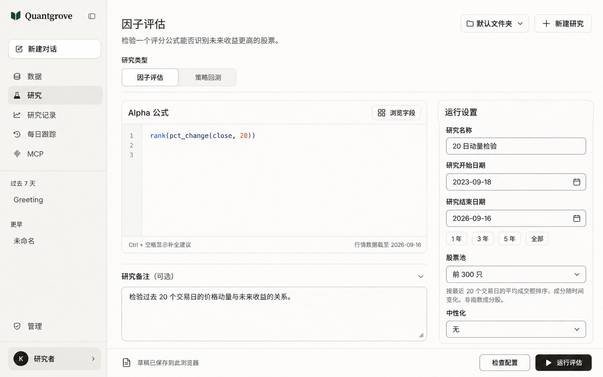

# Research 工作区界面概念稿 v1



- 日期：2026-09-28
- 目标页面：`http://127.0.0.1:5173/research`
- 状态：高保真桌面设计预览，未实施为前端代码
- 生成方式：内置 `image_gen`；初稿生成后，定向微调标题字重和研究类型切换
- 设计依据：当前页面、仓库 [DESIGN.md](../../DESIGN.md) 及其已有的 Perplexity DesignMD 参考
- 图中的研究名称、公式、日期与备注是演示配置，不代表已保存或执行的研究；行情截止日期取自观察时的页面文案，未独立验证数据覆盖。

## 设计要点

1. 宽桌面采用左侧公式编写、右侧运行设置，编辑内容和参数同时可见。
2. 研究类型改为紧凑分段选择，减少顶部灰色容器的视觉占用。
3. 沿用 Quantgrove 品牌、暖白背景和近黑色主按钮；标题降低字重。
4. 备注保留为次要内容；底部操作条集中草稿状态、检查配置与运行入口。
5. 保留当前导航、研究文件夹、新建研究、字段浏览及所有现有表单字段。正式实施时仍需完整保留现有验证、草稿和交互行为。

## 最终提示词组

以下保留实际使用的两步提示词；第二步以第一步生成图为输入，得到最终选定图片。

### 初稿

```text
Use case: ui-mockup
Asset type: high-fidelity desktop web application redesign, single screen, Chinese interface.
Primary request: redesign the supplied screenshot of the Quantgrove Research page into a refined, practical research writing workspace, respecting its existing brand and exact capabilities. Produce a crisp straight-on UI screenshot, approximately 1600 x 1000 landscape, filling the image edge to edge. This is a finished design proposal, not a wireframe or presentation board.
Input image 1: reference for the actual product, navigation, folded-book/leaf logo and controls. Recompose the page at a wide DESKTOP layout. Keep the Quantgrove identity, light theme and information architecture. The reference is not a size or layout constraint.
Design direction: warm, reading-first research. Quiet and confident, professional research software with generous but purposeful spacing and excellent alignment. Use the approved palette: canvas #FCFCF9, sidebar and quiet selected surfaces #F3F2EE, editor surface #FDFBFA, text and primary action #27251E, secondary text #5B5952, dividers #DEDDD6, input outlines #8A8880. Preserve the small forest-green #0F3D2E brand mark. Do not make buttons green. No gradients, decorative artwork, heavy shadows, glass, blue/purple dashboard styling or oversized marketing typography.
Typography: Inter / Noto Sans SC-like sans serif for all interface text; Source Serif 4-like serif only for the Quantgrove wordmark; clear monospace for the formula. Heading about 24px, weight 500, body 14-16px, supporting text at least 12px. Chinese glyphs must be clean and natural, not bold and cramped. Controls 36-40px high; 4/8/12/16/24/32px spacing rhythm; corners 6-12px, larger editor 16px.
Layout:
1. Full height 224px left sidebar with small green folded-book/leaf mark and serif "Quantgrove" wordmark. Keep the subtle collapse icon. A quiet outlined "新建对话" button. Existing navigation in exact order with small consistent line icons: "数据", "研究" (selected on warm gray), "研究记录", "每日跟踪", "MCP". Below, subdued chat-history group labels "过去 7 天" with "Greeting", then "更早" with "未命名". Management link "管理" and compact generic "研究者" account row anchored at bottom; omit all personal email addresses. Sidebar is a calm structural column, not many floating cards.
2. Main area with generous 32px gutters. Header title "因子评估"; below it a single modest supporting sentence "检验一个评分公式能否识别未来收益更高的股票。". At the top right, quiet controls "默认文件夹" with folder icon and chevron, and "+ 新建研究". Do not add breadcrumbs or top navigation.
3. Below header, a COMPACT 40px high research-type switch aligned left, with "因子评估" selected and "策略回测" unselected, preceded by a small "研究类型" label if space permits. Replace the screenshot's large gray radio-card block with this clean compact grouped choice. A subtle full-width divider beneath the mode area.
4. Below that, two aligned columns: broad writing/editor column occupying the available width, then a 300px configuration column separated by a 32px gap. These are the two dominant information groups. The editor gets clear visual priority.
5. Left: a single refined formula editor panel, header "Alpha 公式" on left, quiet "浏览字段" action with a small catalog icon on right. Warm light CodeMirror-like area, fine line-number gutter, tasteful muted syntax highlighting, a single exact line of demonstration code: "rank(pct_change(close, 20))". This line is an illustrative draft, not a result. Show lines 1, 2, 3; modest editor height around 280px; plenty of genuine writing room. At the bottom, a slim footer with "Ctrl + 空格显示补全建议" on left and "行情数据截至 2026-09-16" on right. No green check, validation success or invented metric.
6. Below the editor, a quieter expanded notes area, separated with space and a fine rule rather than heavy card wrappers. Header "研究备注" with small "可选" and disclosure chevron. Plain textarea with a single readable example sentence "检验过去 20 个交易日的价格动量与未来收益的关系。" and ample breathing room. This is user-written example text. Avoid instructional tiles, onboarding cards or extra features.
7. Right: one subtly bounded configuration panel titled "运行设置", with compact vertically stacked labeled fields: "研究名称" containing "20 日动量检验"; "研究开始日期" containing "2023-09-18" with calendar icon; "研究结束日期" containing "2026-09-16" with calendar icon. Beneath the dates, four small date-range choices "1 年", "3 年", "5 年", "全部", none with exaggerated emphasis. Then "股票池" dropdown value "前 300 只". Under this field place the essential short explanation in readable muted text, wrapping naturally: "按最近 20 个交易日的平均成交额排序，成分随时间变化。非指数成分股。". Then "中性化" dropdown value "无". Every field has an obvious label and a clear but fine control boundary. Do not add parameters, metrics, toggles or research features.
8. At the bottom of MAIN CONTENT, a slim pinned action bar with a fine top rule, no shadow, not covering content: left small status icon and text "草稿已保存到此浏览器"; on right outlined secondary "检查配置" and one near-black rounded primary "运行评估" with a small play icon. Buttons use white text only on the primary. The controls and configuration should all be visible together at this wide desktop size.
Constraints: preserve actual product navigation, formula editor, field browsing, notes, name/dates/universe/neutralization, folder/new-research controls and both run actions. Show only this factor-evaluation editor state. No result graphs, invented returns, summary metrics, fake AI suggestions, extra navigation, device mockup frame, browser chrome, watermark, annotations or side-by-side variants. Use the specified Simplified Chinese text verbatim and keep labels crisp. A cohesive, production-plausible interface with noticeably better hierarchy and calmer form density.
```

### 定向微调

```text
Use case: ui-mockup
Edit the provided Quantgrove desktop Research design screenshot. Make ONE targeted refinement: calm the typography and controls in the top header/mode area. Preserve the rest of this exact page and its two-column layout.
- Set the page title "因子评估" to a noticeably smaller and lighter sans-serif 24px logical / about 30px in this image, medium weight 500. Not bold black 700.
- Make the research-type choice a single compact segmented control with the same two labels "因子评估" and "策略回测", no circular radio symbols. Selected segment has a white surface, fine neutral outline and medium text; inactive segment has a subtle warm gray surface and regular text. Keep the entire mode selector about 36px logical height. Keep the small "研究类型" label readable but quiet.
- Section headings, input labels and sidebar selected items should be medium weight, without heavy boldness. All supporting text remains regular.
Invariants: preserve the exact Quantgrove green mark and serif wordmark, warm-white palette, all Chinese text, navigation order, sidebar width, account row, editor size and code "rank(pct_change(close, 20))", the notes, the right configuration panel, all field values, bottom action bar and both actions. Do not invent or remove any controls or change the content. Preserve dimensions and straight-on screenshot format. No annotations or watermark.
```
